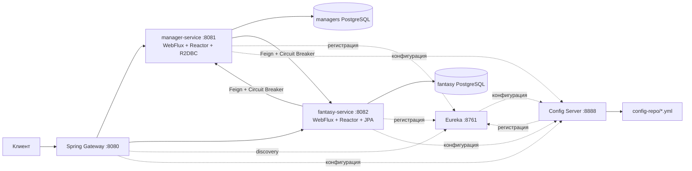

# Fantasy Football — лабораторная работа №2

Декомпозиция монолита лабораторной №1 на два бизнес-микросервиса с отдельными
PostgreSQL и инфраструктурой Spring Cloud. Java 21, Spring Boot 3.5.7,
Spring Cloud 2025.0.0, Reactor, Spring WebFlux, OpenFeign, Resilience4j.
Исходный монолит не изменён. Новая система запускается с собственными пустыми БД;
перенос существующих пользовательских данных из монолита в эту работу не входит.

## Соответствие заданию

| Требование | Реализация |
|---|---|
| Декомпозиция | `manager-service` — менеджеры; `fantasy-service` — игровой контур |
| Регистрация в Eureka | Оба бизнес-сервиса, Gateway и Config Server регистрируются в `discovery-server` |
| Config Server | Порты, БД, маршруты, Eureka, игровые параметры и Circuit Breaker находятся в `config-repo/` |
| Spring Gateway | Все публичные API доступны на `http://localhost:8080/api/v1`; маршруты используют `lb://` и Eureka |
| Feign Client | `fantasy-service → manager-service`: проверка менеджера; `manager-service → fantasy-service`: проверка связанных команд/лиг перед удалением |
| Circuit Breaker | Spring Cloud CircuitBreaker + Resilience4j оборачивают оба Feign-клиента; fallback возвращает 503, отсутствующий менеджер — 404 |
| Reactor + R2DBC | `manager-service`: `ReactiveCrudRepository`, реактивный PostgreSQL-драйвер, `Mono`/`Flux` |
| Reactor + JPA/JDBC | `fantasy-service`: WebFlux-контроллеры возвращают `Mono`, JPA работает внутри `fromCallable(...).subscribeOn(boundedElastic())` |

JPA и Feign являются блокирующими. Их нельзя выполнять на Netty event loop.
В `fantasy-service` **весь вызов транзакционного сервиса** отложен до подписки и
выполняется на `boundedElastic`. Сервис открывает и завершает JPA-транзакцию на этом
рабочем потоке. В R2DBC-сервисе на `boundedElastic` вынесена только проверка через Feign.

## Архитектура



Граница проходит между учётными записями менеджеров и игровым агрегатом.
Команды, составы, трансферы, статистика и лиги тесно связаны транзакциями, поэтому
остаются в одном бизнес-сервисе. Это сохраняет атомарность трансфера и закрытия тура
без распределённой транзакции. Между сервисами передаётся только ID менеджера;
межбазовых JPA-связей и SQL-запросов нет.

## Быстрый запуск

Нужен Docker Compose v2 и работающий Docker daemon. Локальные Java и Maven не нужны.
В корне проекта:

```bash
docker compose up --build -d --wait --wait-timeout 300
docker compose ps
```

Первый запуск требует загрузки Maven-зависимостей и Docker-образов и может занять
несколько минут. Config Server запускается первым, затем Eureka, бизнес-сервисы и
Gateway. После старта Eureka может потребоваться ещё до 30 секунд на обновление
реестра и кэша балансировщика.

| Адрес | Назначение |
|---|---|
| http://localhost:8080/api/v1/managers | CRUD менеджеров через Gateway |
| http://localhost:8080/api/v1/players | Каталог игроков через Gateway |
| http://localhost:8080/docs/managers | OpenAPI менеджеров |
| http://localhost:8080/docs/fantasy | OpenAPI игрового сервиса |
| http://localhost:8761 | Eureka Dashboard |
| http://localhost:8888/manager-service/default | Конфигурация менеджерского сервиса |
| http://localhost:8888/fantasy-service/default | Конфигурация игрового сервиса |
| http://localhost:8080/actuator/health | Состояние Gateway |

Порты бизнес-сервисов и БД не опубликованы на хосте. Gateway публикует только
публичные маршруты; `/internal/**` через него недоступен. Локальные инфраструктурные
порты привязаны к `127.0.0.1`. Это учебная конфигурация без пользовательской
аутентификации; её не следует открывать в Интернет.

Config Server использует профиль `native`: YAML берётся из `/config-repo`,
включённого в образ. Для изменения настроек отредактируйте `config-repo` и пересоберите
контейнеры. Это полноценный Config Server без необходимости отдельного Git-сервера.
Клиенты импортируют обязательный `configserver:`; без него они не стартуют с
незаметно подставленными локальными настройками. Сам Config Server содержит локальную
bootstrap-конфигурацию: он не может загрузить её у самого себя до запуска.

```bash
# Остановить сервисы, сохранив данные:
docker compose down
# Следующий запуск после первой сборки:
docker compose up -d --wait --wait-timeout 300
```

Данные находятся в двух отдельных именованных volumes. Не подключайте volume
лабораторной №1: в игровом сервисе изменён исходный SQL под новую независимую БД.
Демонстрационный каталог и начальный тур переносятся из исходных миграций без
обновления снимка игроков. Актуальность футбольного состава здесь не проверяется.

## Проверка

```bash
# Unit-тесты и сборка всех модулей при установленных Java 21 и Maven:
mvn verify

# Та же проверка без локальной Java/Maven (обычный Docker Desktop):
docker run --rm -v "$PWD:/workspace" -v fantasy-lab2-maven:/root/.m2 \
  -w /workspace maven:3.9.9-eclipse-temurin-21 mvn -B verify

# Полный HTTP-сценарий через Gateway, нужен Python 3:
python3 scripts/smoke.py

# Дополнительно остановить менеджерский сервис, проверить 503 и восстановление:
python3 scripts/smoke.py --resilience
```

Для Colima каталог проекта должен быть доступен виртуальной машине. Если bind mount
показывает пустой каталог, запускайте проект из `~/Downloads` либо используйте
`docker cp` для передачи исходников в контейнер Maven. `docker compose build`
отправляет контекст сборки и не зависит от bind mount исходников.

Smoke-тест создаёт учебные данные со случайным суффиксом и оставляет их для осмотра.
Проверяются CRUD, валидация, пагинация, Feign, 404 для неизвестного менеджера,
15 игроков в составе, успешный трансфер, откат неуспешного трансфера, приватные лиги,
двойные очки капитана, начисление всем 51 командам и защита от повторного закрытия.
`--resilience` на время останавливает только `manager-service` и восстанавливает его
в `finally`, затем ждёт успешного Feign-вызова после восстановления Circuit Breaker.

Два исходных unit-теста из ЛР1 перенесены без изменения утверждений.
Исходный монолитный `FantasyApiIntegrationTest` сохранён в `reference/lab1-tests/`
для сопоставления: он использует MockMvc и единую БД и не запускается как тест
микросервисов. Его основные HTTP/игровые сценарии перенесены в `scripts/smoke.py`.
Новые unit-тесты проверяют выполнение блокирующей работы на worker-потоке,
реакцию на отсутствие менеджера, защиту удаления при сбое, открытие Circuit Breaker
и соответствующие fallback-ответы.

## API

Базовый путь сохранён: `/api/v1`.

| Ресурс | Операции |
|---|---|
| `/managers` | POST, GET; `/{id}` GET, PUT, DELETE |
| `/clubs` | POST, GET; `/{id}` GET, PUT, DELETE |
| `/players` | POST, GET с фильтрами; `/{id}` GET, PUT, DELETE |
| `/fantasy-teams` | POST, GET; `/{id}` GET, PATCH, DELETE |
| `/fantasy-teams/{id}/lineup` | PUT — стартовый состав и капитан |
| `/fantasy-teams/{id}/transfers` | POST — трансфер, GET — история |
| `/gameweeks` | POST, GET; `/{id}` GET, PUT, DELETE |
| `/gameweeks/{id}/start`, `/{id}/finish` | POST |
| `/gameweeks/{id}/performances` | PUT, GET |
| `/leagues` | POST, GET; `/{id}` GET, PUT, DELETE |
| `/leagues/{id}/teams` | POST — вступить |
| `/leagues/{id}/teams/{teamId}` | DELETE — выйти |
| `/leagues/{id}/standings` | GET |

```bash
curl -i -X POST http://localhost:8080/api/v1/managers \
  -H 'Content-Type: application/json' \
  -d '{"username":"student","email":"student@example.org"}'
curl http://localhost:8080/api/v1/players?size=5
```

Правила: 15 разных игроков, позиции 2 GK / 5 DEF / 5 MID / 3 FWD, максимум три
из одного клуба, 11 стартовых, капитан из стартовых, начальный бюджет 100.
Для трансфера нужны доступный игрок той же позиции, достаточный бюджет и открытый
дедлайн. `size` — от 1 до 50; списки игроков/трансферов возвращают `hasNext`, остальные
списки — `X-Total-Count`.

## Отказоустойчивость и границы

Окно Circuit Breaker — 5 вызовов, минимум 3, порог ошибок 50%, открытое состояние
10 секунд, 2 пробных вызова в HALF_OPEN. Feign connect timeout — 1,5 секунды,
read timeout — 2,5 секунды; TimeLimiter — 4 секунды. Ошибки Feign 4xx не учитываются
как недоступность сервиса. Для отсутствующего менеджера fallback сохраняет 404;
при сетевой ошибке, 5xx или открытом circuit — 503. Поддельных успешных ответов нет.

При недоступности `manager-service` создание команды/лиги получает 503, и
транзакция игрового сервиса откатывается. Чтение уже созданных команд, каталог,
трансферы и начисление очков не требуют обращения к менеджерам. При недоступности
игрового сервиса удаление менеджера отклоняется с 503, сохраняя его запись.

Проверка менеджера и запись команды находятся в разных сервисах. Проверка связей
перед удалением не является распределённой транзакцией: одновременные удаление
менеджера и создание команды могут дать гонку. Для данной лабораторной операции
жизненного цикла менеджера следует выполнять последовательно. Производственное
решение потребовало бы протокола резервирования/удаления или saga. Локальные игровые
операции сохраняют транзакционность исходного монолита; глобальная атомарность не
заявляется.

Eureka self-preservation отключён только для локальной демонстрации быстрого
удаления остановленного экземпляра. В production эту настройку нужно пересмотреть.
Пароль `fantasy` — учебное значение; переменная `DB_PASSWORD` меняет пароль для
обеих новых БД и клиентов. Не меняйте её без согласования с уже созданными volumes.

Описание для защиты: [REPORT.md](REPORT.md). Результаты фактической проверки:
[VERIFICATION.md](VERIFICATION.md).

## Документация технологий

- [Совместимость Spring Cloud и Spring Boot](https://spring.io/projects/spring-cloud#overview)
- [OpenFeign и Circuit Breaker; ограничение реактивности Feign](https://docs.spring.io/spring-cloud-openfeign/reference/spring-cloud-openfeign.html)
- [Конфигурация Gateway](https://docs.spring.io/spring-cloud-gateway/reference/configprops.html)

## Запуск уже собранных JAR

Если `mvn verify` уже выполнен и JAR находятся в `*/target/`, повторная
компиляция при сборке образов не нужна:

```bash
docker compose -f compose.yaml -f compose.prebuilt.yaml up --build -d --wait --wait-timeout 300
```

`Dockerfile.runtime` упаковывает те же исполняемые JAR и конфигурацию.
Обычный `docker compose up --build` собирает всё из исходников самостоятельно.
